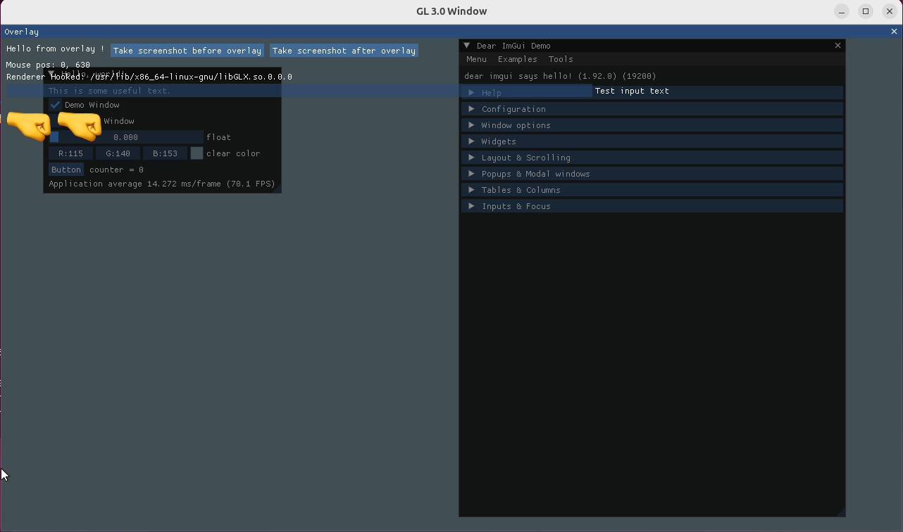
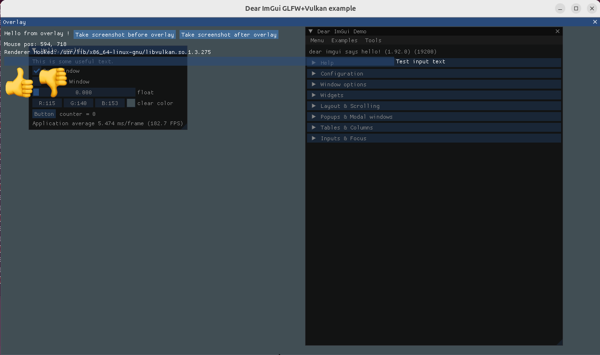
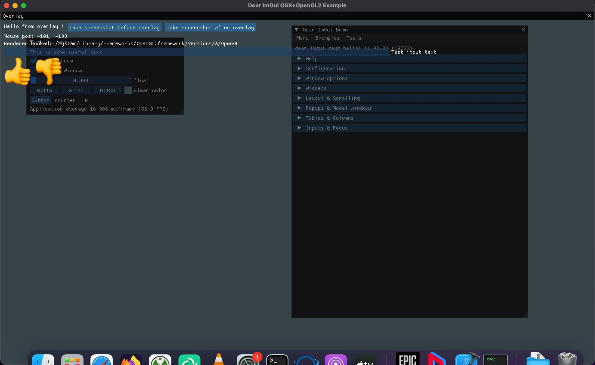
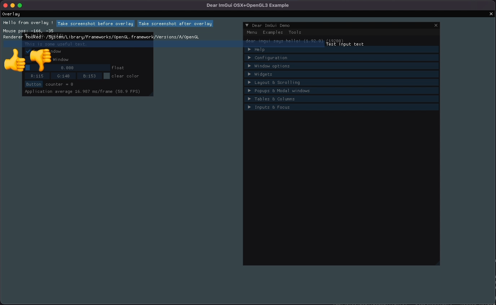

# InGameOverlay

InGameOverlay is a cross-platform library for attaching custom overlays to third-party applications by hooking into their rendering pipeline. Rather than relying on access to the game or application source code, it is designed for injecting UI into processes where the renderer is already in place and the overlay needs to appear alongside the existing frame output.

## Highlights

- Cross-platform support for Windows, Linux, and macOS
- Renderer integration for OpenGL, Vulkan, DirectX 9/10/11/12, and Metal
- Reusable hook and resource infrastructure for overlay rendering
- Designed for injected overlays, tooling, and runtime visualization in external processes

## Linux and macOS overlays in action

These screenshots showcase the overlay running on Linux and macOS environments:









## Building

From the project root, configure and build with CMake:

```bash
cmake -S . -B build
cmake --build build
```

You can also enable the test targets with:

```bash
cmake -S . -B build -DINGAMEOVERLAY_BUILD_TESTS=ON
```

To enable library logs with spdlog, clone the dependency into the bundled deps folder and configure the project with the logging option enabled:

```bash
git clone https://www.github.com/gabime/spdlog deps/spdlog
cmake -S . -B build -DINGAMEOVERLAY_USE_SPDLOG=ON
```

## Project layout

- src/ contains the platform-specific hooks and internal overlay logic
- include/InGameOverlay/ contains the public headers
- tests/ contains example and validation projects for supported renderers

## License

This project is licensed under the GNU General Public License (GPL). See [LICENSE](LICENSE).

## Application MCP tools

`AddMcpTool` copies name, description and JSON object schema; callbacks use byte strings,
an opaque `McpToolResponse_t` and a borrowed UserParameter. Names contain 1-128 ASCII
letters, digits, underscore, hyphen or dot. Built-in and application duplicates are refused.
Registrations survive Stop/Start. Without MCP both registration methods return false.
Callbacks run before OverlayProc on the render thread. SetText/SetError copy response bytes;
the response must not escape the callback. Exceptions become tool errors.

RemoveMcpTool waits for an executing callback without holding the registry or server lock.
A queued call removed before execution returns a tool error without invoking application code.
Self-removal returns false and keeps the tool registered: arrange removal after the callback.
Callbacks may add tools or remove other tools. Do not call Stop, Release, or wait for a
thread that is removing this callback from inside a callback. Start/Stop retain their existing
external lifecycle synchronization requirement. Successful removal allows freeing UserParameter.

Tools list notifications are coalesced by a 10 ms worker, only for initialized connections.
Transport Send calls are serialized with responses, but may originate on this worker as well
as the server thread; Send may PushMcpMessage or add/remove tools, but must not Stop/Release
or wait for a response. No network IO runs in Add/Remove or on the render thread.
